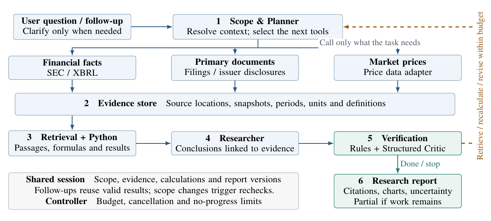

# [Group 6] VeriFin: Evidence-Grounded Financial Research with Structured Verification

**Group 6 - The University of Hong Kong**

| Name | Student ID | HKU email |
|---|---|---|
| HU Xiaobang | 3035974183 | neri@connect.hku.hk |
| Liang Da Wen | 3036656271 | U3665627@connect.hku.hk |
| Yang Yisheng | 3036790534 | u3679053@connect.hku.hk |
| Liao Sijia | 3036806852 | sijialiao@connect.hku.hk |

## Problem and intended use

Students and junior analysts researching a company must combine financial statements, management disclosures, and market observations. A request such as "How has this company performed recently?" can develop into questions about growth, profitability, cash flow, or a comparison with another period or company. VeriFin will help users investigate these questions through an ongoing research conversation and produce conclusions with inspectable evidence and calculations.

A valid citation can still refer to the wrong period or fail to support an explanation. VeriFin emphasizes comparable financial definitions, reproducible calculations, and traceable conclusions across follow-ups. Our research question is whether **structured evidence verification improves the correctness and completeness of multi-source financial research at acceptable latency and cost**. ReAct motivates adapting actions to tool observations, [Shunyu Yao et al. (2023). ReAct: Synergizing Reasoning and Acting in Language Models. ICLR. arXiv:2210.03629.](https://arxiv.org/abs/2210.03629) RARR motivates evidence-based revision, [Luyu Gao et al. (2023). RARR: Researching and Revising What Language Models Say, Using Language Models. ACL, pp. 16477-16508. DOI: 10.18653/v1/2023.acl-long.910.](https://aclanthology.org/2023.acl-long.910/) and ALCE distinguishes answer correctness from citation quality. [Tianyu Gao, Howard Yen, Jiatong Yu, and Danqi Chen (2023). Enabling Large Language Models to Generate Text with Citations. EMNLP, pp. 6465-6488. DOI: 10.18653/v1/2023.emnlp-main.398.](https://aclanthology.org/2023.emnlp-main.398/) Our contribution is their implementation and evaluation in this application.

Initial capabilities cover financial fact lookup, comparable-period or company comparisons, growth and margin calculations, disclosure-based explanations, and descriptive price-window returns. Entities, metrics, periods, and windows are resolved from the request and conversation. Coverage depends on available adapters and data; the initial financial adapter uses SEC data for US-listed issuers. Two or three companies provide development examples, not a product allowlist. New supported issuers must reuse the workflow without company-specific orchestration or prewritten answers. Stock prediction and trading recommendations are outside scope.

## Research workflow and evidence verification

**Resolve and acquire.** The Planner identifies required answer elements, selects tools, and revises its actions using intermediate results. Adapters resolve company identifiers and discover relevant filings or issuer releases within supported sources. "Latest" is resolved using an explicit analysis time and publication records. For an ambiguous request such as "Is performance good?", the system can propose revenue growth and profitability against a stated comparison period, asking only when ambiguity materially affects the answer. The resolved scope is visible and editable. Financial facts, documents, prices, and calculations remain separate tools; an income question need not fetch prices. [U.S. SEC. EDGAR Application Programming Interfaces (APIs). Official documentation. Accessed 8 October 2026.](https://www.sec.gov/search-filings/edgar-application-programming-interfaces)

**Analyze and synthesize.** Adapters map supported financial concepts and distinguish quarterly from cumulative values. Evidence retains source locations, snapshots, business scope, period, publication time, currency, units, and accounting basis where applicable. Cross-period and cross-company comparisons check these dimensions; unavailable or non-comparable data is reported rather than silently substituted. A small tested calculation library computes ratios, changes, and returns with inspectable formulas and operands. The Researcher connects results into conclusions, separating observations, management attribution, and analytical interpretations with their assumptions and limits.

**Verify and revise.** Rules check references, financial context, and arithmetic. One Structured Critic reads the request, resolved scope, required answer elements, current claims, and original evidence. It checks each claim and required-answer item against predefined issue categories: unsupported statements, source/time mismatch, numerical inconsistency, causal overstatement, omissions, and material conflicting evidence. Agreement with selected passages alone cannot establish comprehensive research. A failed query does not disqualify its entire document. Evidence changes invalidate dependent results; new or changed conclusions are checked before inclusion.

**Critic feedback.** Each issue uses `target_id`, `issue_type`, `evidence_refs`, `missing_support`, and `proposed_action`. The target identifies a claim or required-answer item, so omissions need no existing claim. Evidence references locate source spans or calculation records and may be empty when evidence is absent; missing support describes the gap. Proposed actions are advisory: the Planner selects feasible retrieval, recalculation, or wording changes within budget. For example, a period mismatch links the affected claim and evidence; the Planner can fetch the correct period, recompute dependent results, and request another check.

**Control work.** Each research episode has configurable model/tool-call and active-execution-time limits shared by its subtasks and revisions. Waiting for clarification pauses execution time without resetting consumed calls or cost. The controller checks required-answer coverage and stops on completion, exhausted budget, cancellation, or repeated attempts without usable progress. Failed calls and retries count toward resource use; development trials set limits before evaluation. Reports distinguish Supported, Partially Supported, Insufficient Evidence, and Conflicting Evidence relative to the current evidence. Budget-limited or blocked results are marked partial, with unanswered items and unavailable verification explicit.

## Multi-turn research sessions

A **session persists across turns**, retaining the conversation, resolved scope, evidence references, calculations, conclusions, open questions, and report versions. Each initial request or substantive extension creates work within that session. Clarification replies update pending work. Questions about an existing result use its saved evidence and formulas, with retrieval only when needed. Additional metrics, periods, or companies extend the plan and trigger the missing work.

Follow-ups such as "What about last year?" use the active context. "Compare with company B" retains both companies; "switch to B" changes the active company. Corrections or changes to period, metric definition, or information cutoff trigger checks of affected dependencies while preserving unrelated valid evidence and earlier report versions. Conversation summaries manage context length but do not replace source evidence. Time-sensitive requests refresh data where access permits; historical replay mode displays its coverage.

Users can inspect sources and formulas, follow progress, stop execution, reopen saved sessions, continue research, and export Markdown reports and CSV tables. Stopping prevents further scheduling; interrupted work is not shown as completed. A user-requested extension or continuation may receive a new finite work allowance while preserving session context and cumulative usage. Persistent background execution, cross-session personalization, and multi-user accounts are not first-version commitments.

## Provisional stack and model choice

| Component | Choice and rationale |
|---|---|
| Orchestration | Python and LangGraph for explicit state and conditional tool use; a small Python state machine is the fallback. [LangChain. LangGraph overview: durable execution, state and persistence. Official documentation. Accessed 8 October 2026.](https://docs.langchain.com/oss/python/langgraph/overview) |
| Storage and tools | SQLite session/evidence metadata, file snapshots, and typed adapters for inspection and reuse. |
| Retrieval | Company/period filters with dense retrieval; BM25+dense is a comparison and reranking is optional. |
| Analysis and UI | Tested calculation functions, Pandas, Plotly, and Streamlit for a conversational interface with sources and charts. |
| Market data | One replaceable adapter plus historical snapshots for replay; Futu depends on actual access checks. |

Our provisional model is **Qwen3.7-Plus (`qwen3.7-plus-2026-05-26`) through Alibaba Cloud Model Studio**, with separate calls for planning, synthesis, and critique. Documented function calling and JSON Schema output fit the tool and evidence interfaces. [Alibaba Cloud. Function Calling. Model Studio documentation. Accessed 8 October 2026.](https://www.alibabacloud.com/help/en/model-studio/qwen-function-calling) [Alibaba Cloud. Structured output. Model Studio documentation. Accessed 8 October 2026.](https://www.alibabacloud.com/help/en/model-studio/qwen-structured-output) The Hong Kong workspace offers Global deployment; the endpoint does not imply Hong Kong-only inference. Qwen3.7-Flash (`qwen3.7-flash-2026-07-15`) is a lower-cost fallback. [Alibaba Cloud. Regions and endpoints. Model Studio documentation. Accessed 8 October 2026.](https://www.alibabacloud.com/help/en/model-studio/regions) [Alibaba Cloud. Model availability and pricing. Model Studio documentation. Accessed 8 October 2026.](https://www.alibabacloud.com/help/en/model-studio/model-pricing)

Tool calling and structured output motivate this starting choice; actual financial quality remains an empirical question. A small development check measures access, evidence use, multi-turn consistency, latency, and token cost before configuration is frozen. One model keeps integration and comparisons manageable, but correlated generation/critique errors remain a risk. Record model snapshots, prompts, settings, and source snapshots; use the fallback if access, waiting, or cost is unsuitable and it meets the same quality checks.

## Evaluation supporting design decisions

**E1, primary: verification.** Give four conditions the same model-generated claims, evidence, and calculations: no verification; rules only; rules plus substantive generic review; and rules plus Structured Critic. Both review conditions share the request, required-answer checklist, evidence, rule findings, model, context/output limits, and available corrective actions. Generic review requests an open-ended assessment of correctness, support, and completeness with free-form findings and suggested actions; it prescribes neither a per-item checking procedure nor issue records. Structured Critic uses the per-item/category checks and feedback fields in Section 2. The same Planner/executor interprets either feedback form under equal resource limits. This comparison evaluates the complete structured verification scheme; gains cannot be attributed to output format, prompting, or checking procedure alone.

Compare detection with frozen evidence before allowing revision. Score both feedback forms against the same annotated issues, regardless of wording or format, then measure revision outcomes. Report correct required-content coverage, unsupported assertions, detection precision/recall, corrections, regressions, latency, and cost, including feedback interpretation and revision. Include omissions and conflicting evidence in diagnostics. Removing correct required content cannot count as improvement. Natural outputs and injected-error diagnostics remain separate.

**E2, supporting: planning.** Compare an adaptive Planner with a carefully designed task-type fixed workflow using the same tools, sources, model, verification, and budgets. Both receive the same request and conversation context, without private answers or a gold tool sequence. Include direct questions, source failures, dates needing resolution, and follow-ups that change the plan. Accept equivalent valid paths. Measure completion, mistaken/repeated calls, answer quality, and cost before and after verification. Document-only RAG remains a descriptive reference because its tool access differs.

**E3, secondary: retrieval.** Compare dense and hybrid retrieval on the same corpus, queries, filters, and retrieval budget; measure relevant-evidence recall and retrieval latency to inform the retrieval choice.

**Application acceptance.** Run complete research conversations, including an issuer absent from development, an explanation of a saved result, a new comparison, a scope correction, and a request outside current data coverage. Check referent resolution, evidence reuse, stale-evidence rejection, answer completeness, and reopening/continuing a saved session. Inspect real logs rather than screenshots of preset answers. These checks verify product behavior alongside the component comparisons.

**Pilot and annotation.** The existing 18 questions are development/diagnostic material. Plan 12 held-out research cases from new events, including short dialogues and an unseen issuer; related turns and perturbations stay in the same split. Two members independently annotate required content, source support, calculations, and legitimate gaps, resolving disagreements before scoring. Gold remains outside agent inputs. Human assessment checks claim-passage support rather than system badges. Freeze budgets and quality/cost tolerances after development; report per-case failures without broad generalization.

## Feasibility risks and delivery

Preliminary checks acquired SEC facts, issuer disclosures, and historical prices for Microsoft FY2025 Q2 and NVIDIA FY2025 Q4. Microsoft illustrates a scope error: a disclosure about declining Cloud gross margin cannot establish declining consolidated operating margin when that margin rose. [Microsoft (2025). FY2025 Q2 earnings: performance disclosures. Investor Relations.](https://www.microsoft.com/en-us/Investor/earnings/FY-2025-Q2/performance) NVIDIA illustrates a USD 1 million difference between a derived prior-year quarterly figure and an explicit quarterly table. [NVIDIA (2025). CFO Commentary on Fourth Quarter and Fiscal 2025 Results. Investor Relations.](https://investor.nvidia.com/files/doc_financials/2025/Q425/Q4FY25-CFO-Commentary.pdf) [NVIDIA (2025). Form 10-K, fiscal year ended 26 January 2025. SEC accession 0001045810-25-000023.](https://www.sec.gov/Archives/edgar/data/1045810/000104581025000023/nvda-20250126.htm) [NVIDIA (2024). Form 10-Q, quarter ended 27 October 2024. SEC accession 0001045810-24-000316.](https://www.sec.gov/Archives/edgar/data/1045810/000104581024000316/nvda-20241027.htm) These data, calculations, and fixture-based framework runs support component feasibility. Autonomous model integration, multi-turn interaction, and effectiveness evaluation are planned project work, not completed results.

**Principal risks.** Data access and financial normalization may demand more effort than orchestration: reusable adapters, metric mappings, and comparability checks take priority. Same-model critique can share errors or overlook missing evidence, so evaluate coverage and misleading omissions alongside citation support. Explicit session scope and dependency checks address context drift. To control workload, prioritize the complete research conversation, reusable acquisition, calculation, and verification; defer optional sources and retrieval refinements rather than restricting company coverage to prepared examples. Matched comparisons and independently reviewed gold limit evaluation bias.

**Delivery.** Connect a model-driven episode to the preserved Microsoft event, then test source discovery on another covered issuer. Complete multi-turn behavior, persistence, execution controls, and export before freezing the pilot. Our four-person team covers data, orchestration/calculation, verification/evaluation, and interface/integration, with peer review. Deliver runnable code, setup instructions, source/configuration records, evaluation, and limitations. Disclose external code, data, dependencies, and AI assistance; every member must explain and modify the system.

## Optional extensions

After the core application meets its acceptance criteria, the most relevant extensions are **earnings-call transcripts or selected financial news** to address missing explanatory context, and **reranking** if retrieval errors remain a bottleneck. Each additional source retains provenance and publication-time checks; news or management commentary does not establish causality by itself. Macroeconomic data can support questions that need broader context. A second Researcher with an Arbiter, or a different-model verification pass, is a later experiment if observed failures justify its cost. These are optional investigations, not first-version deliverables. Live monitoring and complex confidence calibration are outside the initial commitment.
